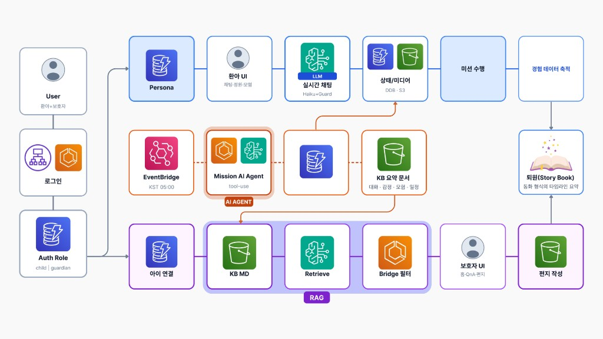

# Beddy 🧸 — 장기 입원 청소년을 위한 AI 정서 돌봄 동반자💙

> **누구를 위해**: 병원 생활이 길고 외로운 **청소년 환아**, 그리고 “오늘 우리 아이 마음은 어땠을까?”를 걱정하는 **보호자**
> **무엇을**: 아이만의 AI 친구와 대화하고, 새벽 Agent가 하루 미션을 준비하며, 보호자에게는 **대화 원문이 아닌 요약만** 전하는 프라이버시 우선 돌봄 플랫폼


**AWS 해커톤 수상 프로젝트** · 비임상(진단·처방 금지) · Guardrail + Bridge 프라이버시



---

## 목차

1. [서비스 정의](#1-서비스-정의)
2. [핵심 파이프라인 설계 (LLM · Agent · RAG)](#2-핵심-파이프라인-설계-llm--agent--rag)
3. [기술 스택 & 아키텍처](#3-기술-스택--아키텍처)
4. [설치 · 실행 방법](#4-설치--실행-방법)
5. [환경 변수 · 주요 의존성](#5-환경-변수--주요-의존성)
6. [시연 시나리오 (대표 · 엣지 케이스)](#6-시연-시나리오-대표--엣지-케이스)
7. [프로젝트 구조](#7-프로젝트-구조)
8. [문서 · 데모 · 라이선스](#8-문서--데모--라이선스)

---

## 1. 서비스 정의

### 문제
입원 기간의 병목은 “일정표”만이 아니다.  
아이는 **말할 곳이 부족**하고, 보호자는 **대화 원문을 다 볼 수 없으면서도** 아이의 하루를 이해하고 싶다.  
일반적인 챗봇은 의료 조언을 흘리거나, 부모에게 원문을 그대로 넘겨 신뢰를 깨기 쉽다.

### 대상 사용자
- 장기 입원 중인 **청소년 환아** (페르소나 기반 비밀친구)
- 아이와 계정을 연동한 **보호자 / 보호자 앱 사용자**
- 병원 일정·정서 기록을 **안전하게** 남기고 싶은 돌봄 환경

### 제공 가치

| 사용자의 질문 | Beddy의 답 |
|---|---|
| 병원에서도 나만의 친구가 있을까? | 설문 기반 페르소나 + Guardrail LLM 실시간 대화 (SSE) |
| 오늘 뭐 하면 마음이 덜 힘들까? | 새벽 **Mission Agent**(tool-use)가 상태에 맞는 미션 설계 |
| 부모는 대화를 다 보나? | **아니요.** Bridge·RAG로 **요약만** 전달 (원문·일기 비공개) |
| 위험 신호를 흘려보내나? | 위기 감지 → 공감·도움 버튼(보호자/간호사/109/119) → 보호자 **요약 알림** |

### 핵심 사용자 흐름

```
회원가입/로그인 (child | guardian)
  → 아이: 온보딩(성격·취미) → 페르소나·동물 아바타 → 채팅·정원·소원·모험
  → 새벽: EventBridge → Mission Agent → KB 요약 문서
  → 보호자: 연동 코드 → 홈/공감가이드/Q&A(RAG) → 편지
  → 퇴원: 스토리북으로 하루들이 동화처럼 남음
```

---

## 2. 핵심 파이프라인 설계 (LLM · Agent · RAG)

> **설계 원칙**: LLM은 “친구로 말하는” 한 축일 뿐이다.  
> **Agent**는 도구를 골라 하루를 준비하고, **RAG**는 보호자에게 근거 있는 요약만 제공한다.  
> 단순 `입력 → LLM 1회 → 출력`이 아니라 **역할이 갈라진 멀티 파이프라인**이다.

상단 아키텍처 이미지가 전체 구조입니다. 흐름만 요약하면:

```text
Login
  │
  ├── CHILD ────── Persona → LLM 채팅(Guardrail·SSE) → 정원·소원·미션
  │                      │
  │                      ▼
  │               경험 데이터 축적
  │                      │
  │                      ▼
  │         DAWN 05:00  EventBridge → Mission Agent (tool-use)
  │                      │              plan → validate → repair
  │                      ▼
  │               KB 요약 MD (Bridge: 원문·좌표 제거)
  │                      │
  └── GUARDIAN ◄── RAG (요약만) ── Home · Empathy · Q&A · 편지
                         │
                         ▼
                Discharge Storybook
```

| Stage | 역할 | 핵심 |
|:-----:|------|------|
| **Child** | 낮 경험 | Persona + Guardrail LLM + 미션·정원·소원 |
| **Dawn** | 새벽 준비 | Agent가 도구를 골라 오늘 미션·KB 요약을 준비 |
| **Guardian** | 보호자 | 원문 없이 요약만 RAG로 확인 |
| **Storybook** | 퇴원 | 두 경로의 기록이 동화형 타임라인으로 합류 |

### 세 능력의 역할 분리

| 구분 | 무엇인가 | 언제 | 하지 않는 것 |
|---|---|---|---|
| **LLM** | Guardrail 걸린 동반자 대화 | 낮, 실시간 | 진단·처방·자해 방법 안내 |
| **Agent** | tool-use로 오늘 미션 설계 | 새벽 배치 | 단순 스케줄 크론이 아님 — **도구 선택이 모델 판단** |
| **RAG** | 보호자용 요약 KB 검색 답변 | 보호자 Q&A·인사이트 | 의료 논문 검색·원문 채팅 검색 |

### “단순 챗봇 API”와 다른 점
- **검색(RAG)**: 보호자 답은 KB 요약 근거 (환각·원문 유출 완화)
- **판별**: Auth role, 위기 키워드, 미션 scene(low_energy 등)
- **분기**: child 채팅 ↔ dawn Agent ↔ guardian RAG
- **멀티스텝(Agent)**: 도구 호출 루프 → 플랜 제출 → 검증/수리
- **검증·안전**: Guardrail 토픽 DENY + 프롬프트 프로토콜 + 앱 위기 UI

> 채팅: `POST /api/conversation?stream=1` · Agent: `runMissionAgent()` · RAG: `retrieveGuardianContext()`

---

## 3. 기술 스택 & 아키텍처

| 영역 | 사용 기술 |
|---|---|
| 앱 | Next.js 14 (App Router), TypeScript, Tailwind CSS |
| 런타임 | Amazon ECS Fargate + ALB |
| AI | Amazon Bedrock Converse / Stream, Guardrails, Knowledge Base, 이미지 모델, Polly |
| 데이터 | DynamoDB, S3 (아바타·미디어·KB MD) |
| 배치 | EventBridge → `/api/cron/daily` |
| 비밀값 | AWS Secrets Manager |
| 관측 | CloudWatch + 구조화 로그 |

**계층**: `src/app`(라우트·API) → `frontend/features`(UI) → `backend/features`(도메인) → `backend/ai`(LLM·Agent·RAG·Bridge) → AWS.

**왜 ECS인가**: 채팅 SSE 이후 저장·감정 분석 등 **응답 뒤 백그라운드**와 새벽 배치가 프로세스가 살아 있어야 해서 Fargate를 사용한다. (요청 종료와 함께 죽는 모델보다 적합)

---

## 4. 설치 · 실행 방법

### 사전 준비
- Node.js 20+
- (선택) AWS 계정 · Bedrock 모델/가드레일/KB 접근 권한

### 로컬 실행
```bash
# 1) 클론
git clone <YOUR_REPO_URL>
cd <project-root>

# 2) 의존성
npm install

# 3) 환경 변수
cp .env.example .env.local
# 처음엔 LLM_PROVIDER=mock 으로 UI·플로우만 확인 가능

# 4) 개발 서버
npm run dev
```

Open [http://localhost:3000](http://localhost:3000)

### 상태 확인
```bash
curl http://localhost:3000/api/health
npm run check:bedrock   # Bedrock 연결 시
```

### AWS 배포 (요약)
PowerShell 스크립트: `scripts/deploy/`  
자세한 체크리스트: [`docs/production/05-DEPLOYMENT_CHECKLIST.md`](docs/production/05-DEPLOYMENT_CHECKLIST.md)

---

## 5. 환경 변수 · 주요 의존성

### 환경 변수 (발췌)

| 변수 | 설명 |
|---|---|
| `LLM_PROVIDER` | `mock` \| `bedrock` |
| `PERSISTENCE` | `json`(로컬 `.data/`) \| `dynamodb` |
| `AUTH_SESSION_SECRET` | 세션 HMAC 키 (≥32자, 실값 커밋 금지) |
| `BEDROCK_MODEL_ID_CHAT` | 실시간 채팅 (Haiku 계열) |
| `BEDROCK_MODEL_ID_QUALITY` | 배치/품질 작업 |
| `BEDROCK_GUARDRAIL_ID` / `VERSION` | 안전 가드레일 |
| `BEDROCK_KB_ID` | 보호자 RAG용 Knowledge Base |
| `CRON_SECRET` | 새벽 배치 API 헤더 |

전체 목록은 [`.env.example`](.env.example) 참고.

### 주요 npm 의존성
```text
next, react, typescript, tailwindcss
@aws-sdk/client-bedrock-runtime
@aws-sdk/client-bedrock-agent-runtime
@aws-sdk/client-dynamodb, @aws-sdk/lib-dynamodb
@aws-sdk/client-s3, @aws-sdk/client-polly, @aws-sdk/client-cloudwatch
bcryptjs, framer-motion, lucide-react, sharp, vitest
```

```bash
npm install   # package.json 기준 일괄 설치
```

---

## 6. 시연 시나리오 (대표 · 엣지 케이스)

### 대표 케이스 — 의도대로 정상 작동

| # | 입력 / 행동 | 기대 동작 |
|---|---|---|
| 1 | 아이 가입 → 온보딩(성격·취미) → mirror/custom | 페르소나 저장, 동물 아바타 후보 생성·선택 |
| 2 | 대기실에서 일상 대화 | Guardrail LLM SSE 응답, 메모리/감정은 응답 후 비동기 처리 |
| 3 | 보호자 연동 코드로 연결 | `/guardian` 홈에 하루 요약·공감 가이드 (원문 없음) |
| 4 | 새벽 배치 이후 모험 화면 | Agent가 준비한 오늘 미션 표시 |
| 5 | 보호자 Q&A “오늘 기운은?” | RAG가 KB 요약 검색 후 근거 있는 답 |

### 엣지 케이스 — 안전·결측·과부족

| # | 상황 | 기대 동작 |
|---|---|---|
| E1 | 자해·자살 관련 발화 | 위기 UI(보호자/간호사/109/119) + 보호자 **요약 알림** (원문 비공유) |
| E2 | 의료 진단·약 용량 질문 | Guardrail/프롬프트가 차단·보호자·간호사로 안내 |
| E3 | 전날 미션 미완료 | 패널티 없음. **오늘 미션은 여전히 생성** |
| E4 | Bedrock 장애 + `LLM_FALLBACK_TO_MOCK` | 로컬/데모는 mock 폴백 (운영 ECS는 false 권장) |
| E5 | 보호자가 프라이버시 토글 OFF | 감정/모험/기억 하이라이트 해당 항목 숨김 (`hidePrivateChat`은 항상 true) |

---

## 7. 프로젝트 구조

```
src/
├─ app/                      # Next.js 페이지 · /api/* 브리지
│  ├─ api/conversation/      # SSE 채팅
│  ├─ api/cron/daily/        # EventBridge 배치 진입점
│  ├─ api/parent/            # 보호자 대시보드 API
│  └─ guardian/              # 보호자 UI 라우트
├─ frontend/features/        # UI (waiting-room, emotion-garden, parent, …)
├─ backend/
│  ├─ features/              # 도메인 서비스·스토어
│  └─ ai/
│     ├─ llm-gateway.ts      # 모델 라우팅·관측
│     ├─ agent/              # tool-use Mission Agent
│     ├─ rag/                # Guardian RAG
│     ├─ bridge/             # 원문·좌표 필터
│     └─ prompts/safety.ts   # 안전·자살예방 프로토콜
docs/
├─ architecture/             # 다이어그램
├─ aws/                      # 통합·스텝 노트
├─ demo/ · production/ · presentation/
scripts/
├─ deploy/                   # ECS·Guardrail·KB·EventBridge
├─ seed/ · migration/ · docs/
```

> **네이밍 메모**: UI는 `/guardian`, 대시보드 API·도메인은 역사적으로 `parent`를 사용. 공개 API 계약을 깨지 않기 위해 일괄 리네임은 보류.

---

## 8. 문서 · 데모 · 라이선스

| 문서 | 내용 |
|---|---|
| [`docs/README.md`](docs/README.md) | 문서 인덱스 |
| [`docs/architecture/`](docs/architecture/) | 시스템·AI 플로우 다이어그램 |
| [`docs/production/`](docs/production/) | 아키텍처 확정·보안·배포 체크리스트 |
| [`docs/demo/step7-demo.md`](docs/demo/step7-demo.md) | 시연 노트 |
| [`docs/api/README.md`](docs/api/README.md) | API 맵 |

### 스크립트
| 명령 | 용도 |
|---|---|
| `npm run dev` | 로컬 개발 |
| `npm test` | Vitest |
| `npm run seed:dynamo` | 데모 유저 시드 |
| `npm run check:bedrock` | Bedrock 스모크 |

### License
MIT — see [LICENSE](LICENSE).

### Disclaimer
Beddy는 **정서 돌봄 동반자**이며 의료기기·진단·응급 서비스가 아닙니다.  
위기 시 지역 응급체계 또는 자살예방 상담전화 **109** / 응급 **119**를 이용해 주세요.

---

<sub>Beddy · AWS Hackathon · LLM + Agent + RAG · Privacy-first companion for hospital teens</sub>
