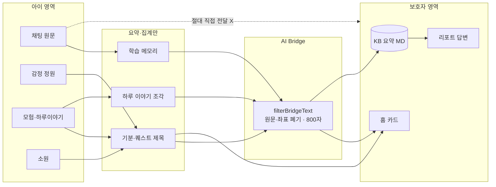
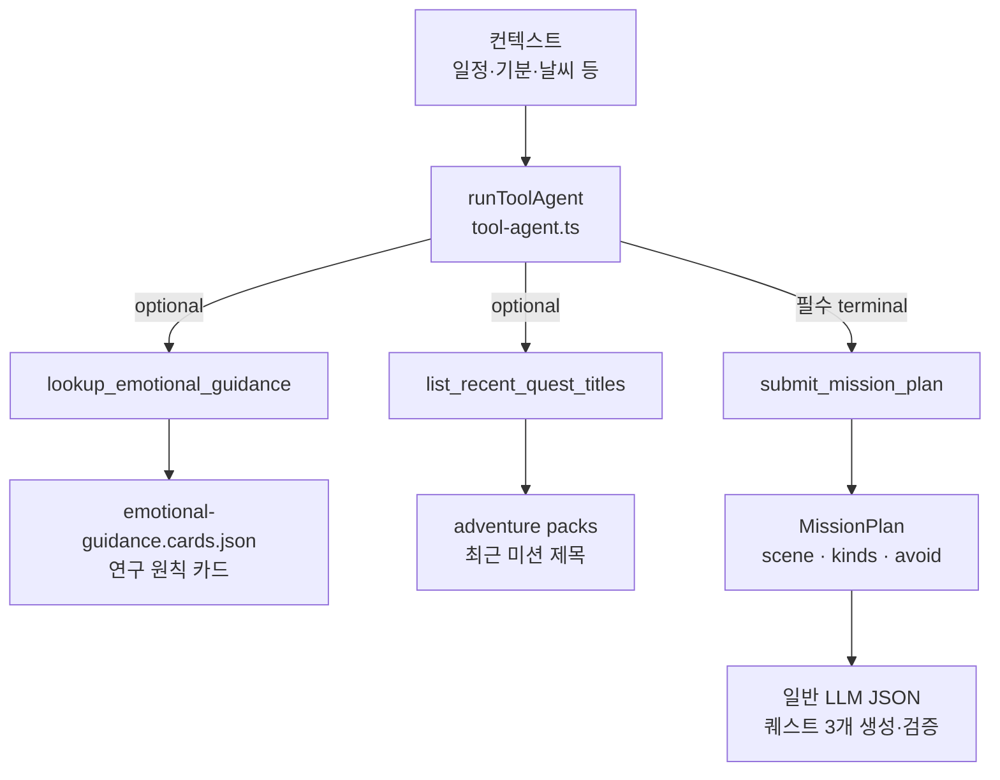
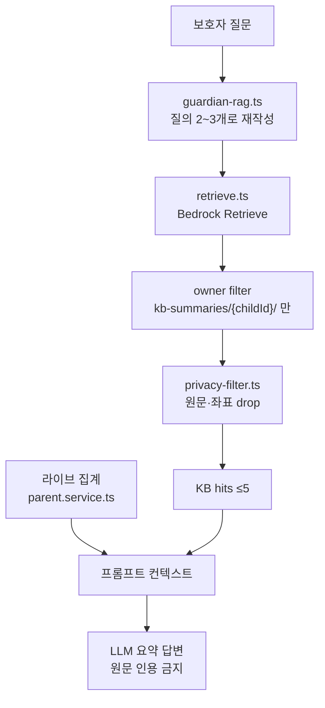

# AI Agent · 보호자 RAG — 한눈에 그리는 법

**목적:** 발표/문서용 다이어그램을 **3장**으로만 고정.  
**핵심 구분:** Mission Agent(tool-use) ≠ Guardian RAG(검색 파이프라인)

Canvas: 옆 채팅에서 `ai-agent-rag-flows.canvas.tsx` 열기  
기존 SVG: `docs/architecture/agent-tooluse-flow.svg`, `docs/architecture/architecture-service-flow.svg`

---

## Slide A — Child / Bridge / Parent (경계)



**그릴 때:** 원문→보호자 화살표는 **점선 + X**. 실선은 요약만.

---

## Slide B — Mission Agent (tool-use)

**유일한 Bedrock Agent.** 채팅·RAG는 Agent가 아님.



| Tool | 역할 | 데이터 |
|------|------|--------|
| `lookup_emotional_guidance` | 정서 배려일만 원칙 카드 | `ai/agent/guidance/emotional-guidance.cards.json` |
| `list_recent_quest_titles` | 제목 중복 방지 | DynamoDB adventure packs |
| `submit_mission_plan` | 계획 확정 후 루프 종료 | 모델 출력 → `MissionPlan` |

**코드 경로**

```
adventure-quest.agent.ts  (planMission)
  → runToolAgent  (ai/agent/tool-agent.ts)
  → tools         (adventure-quest.tools.ts)
  → 이후 generate/validate = runLlm (tools 없음)
```

---

## Slide C — Guardian RAG (파일 · 정보)

**tool-use 없음.** 질의 재작성 → KB 검색 → Bridge → (라이브 집계와 합쳐) 답변.



### KB에 올라가는 파일 (새벽 `index-summaries.ts`)

| kind | 정보 | 읽는 스토어 |
|------|------|-------------|
| `memory` | 어투·톤·테마·영속 사실 | `conversation.store` (원문 X) |
| `emotion` | 최근 꽃 날짜·기분 라벨 | `emotion-garden.store` |
| `mission` | 퀘스트 제목·헤드라인·하루이야기≤200자 | `adventure-quest` |
| `timeline` | 이벤트 제목+요약≤120자 | `memory-timeline` |
| `interests` | 성향·소원 | `persona` + `wish-tree` |

S3: `kb-summaries/{childUserId}/{date}-{kind}.md`

### 답변 시 추가로 붙는 라이브 정보 (`parent.service` report)

- 오늘 기분 / 주간 감정 (토글 `shareEmotionTrends`)
- `formatMemoryForPrompt` 학습 메모리 요약
- 완료 모험 제목 (토글 `shareAdventures`)
- 소원 개수
- 하루 이야기 조각 (토글 `shareMemoryHighlights`)
- KB hits (`formatKbHitsForPrompt`)

### 핵심 파일 맵

| 파일 | 한 줄 |
|------|--------|
| `ai/rag/guardian-rag.ts` | RAG 파이프라인 |
| `ai/kb/retrieve.ts` | Bedrock Retrieve + 아이 스코프 |
| `ai/kb/index-summaries.ts` | 요약 MD 인덱싱 |
| `ai/bridge/privacy-filter.ts` | 원문·좌표 차단 |
| `features/parent/parent.service.ts` | 질문·집계·답변 조립 |
| `features/batch/kb-index.job.ts` | 새벽 인덱싱 잡 |

---

## 한 줄 요약 (외우기)

1. **아이 채팅** = Haiku 스트림 (tools 없음)  
2. **미션 Agent** = guidance / titles / submit 세 도구  
3. **보호자** = 요약만 · Bridge · KB 5종 MD + 라이브 집계 · 원문 금지  

---

## PPT 배치 팁

| 위치 | 내용 | 소스 |
|------|------|------|
| 왼쪽 1/3 | Child 원문 박스 (잠금) | Slide A |
| 가운데 | Bridge 세로 바 | Slide A |
| 오른쪽 | Parent 카드·RAG | Slide A/C |
| 별도 슬라이드 | Agent 도구 3개 | Slide B 또는 `agent-tooluse-flow.svg` |
