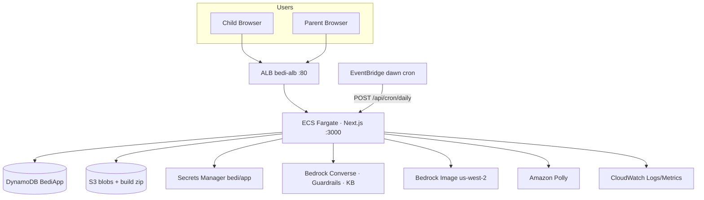
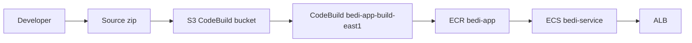
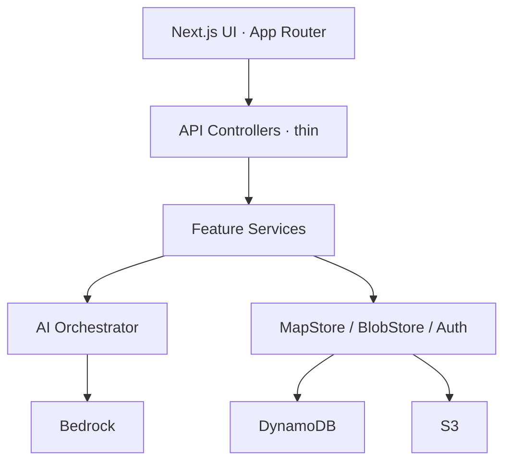
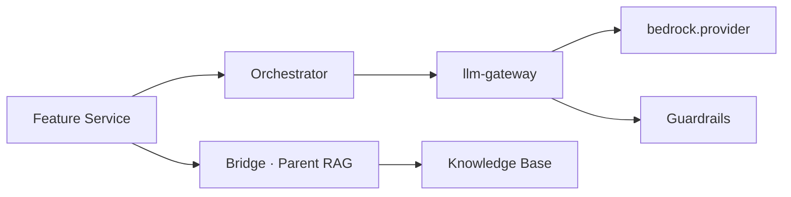

# Beddy (Bedi) — AWS 아키텍처 발표 자료

**대상:** 해커톤/데모 심사 · 5–8분  
**Region:** `us-east-1` (이미지 Bedrock만 `us-west-2`)  
**라이브:** `http://bedi-alb-1051798792.us-east-1.elb.amazonaws.com`  
**정본:** `docs/production/00-FINAL_ARCHITECTURE.md`, `01-FINAL_AWS.md`

---

## 0. 오프닝 한 줄

> 병원 아이에게는 **비밀 친구**, 보호자에게는 **따뜻한 요약만**.  
> 원문 채팅은 보호자에게 가지 않고, AI는 Orchestrator + Privacy Bridge 뒤에서만 동작합니다.

---

## 1. 전체 AWS 아키텍처 (슬라이드용 Mermaid)

PPT/Notion/GitHub에서 Mermaid를 렌더하거나, 아래 SVG를 그대로 삽입하세요.

**권장 이미지:** [`docs/architecture/architecture-aws.svg`](../architecture/architecture-aws.svg) (1920×1080)



### 배포 파이프라인



스크립트: `scripts/deploy/04-deploy-ecs-east1.ps1` (로컬 Docker 불필요)

---

## 2. 앱 레이어 (코드 구조)



| 레이어 | 경로 | 규칙 |
|--------|------|------|
| Frontend | `src/frontend/**` | `"use client"`에서 `@/backend` 금지 |
| Controllers | `src/app/api/**` | `withApiGuard` + `requireAuth*` |
| Services | `src/backend/features/**` | 비즈니스 로직 |
| AI | `src/backend/ai/**` | Converse는 Orchestrator만 |
| Persist | DynamoDB + S3 | Aurora **폐기** |

---

## 3. AI · 프라이버시 (핵심 차별점)



| Purpose | 모델 | 용도 |
|---------|------|------|
| `chat` / `analysis` | Claude Haiku | 아이 채팅 SSE, 가벼운 분석 |
| `quality` | Claude Opus | 새벽 배치 · 보호자 요약 · 이야기 |
| Image | Stability (us-west-2) | 아바타 · 일정 만화 · 동화 삽화 |
| TTS | Polly | 이야기책 낭독 |

**Child vs Parent**

| | Child | Parent |
|--|-------|--------|
| 채팅 | 전체 이력 (최대 80) | **원문 없음** |
| AI | Haiku 스트림 핫패스 | Bridge + KB + Opus 요약 |
| 연결 | 초대 코드 발급 | 링크 + privacy toggles |

---

## 4. 런타임 플로우 두 가지

### Hot path — 아이 채팅

```
POST /api/conversation (SSE)
  → Auth → context
  → Guardrail + Haiku stream
  → SSE done (입력 잠금 해제)
  → async: persist + heuristic memory/emotion
```

### Dawn batch — EventBridge

```
05:00 KST → POST /api/cron/daily
  → memory → emotion → stories → missions → parent → KB index
```

규칙: `bedi-dawn-daily-batch` · `cron(0 20 * * ? *)` · 헤더 `x-bedi-cron-secret`

---

## 5. AWS 서비스 치트시트 (심사 Q&A)

| 서비스 | 이름/비고 | 상태 |
|--------|-----------|------|
| ECS Fargate | `bedi-cluster` / `bedi-service` · 1024 CPU / 2048 MB · desired 1 | Live |
| ALB | `bedi-alb` · TG `:3000` · health `/login` · **HTTP only** | Live |
| ECR | `bedi-app` | Live |
| CodeBuild | `bedi-app-build-east1` | Live |
| DynamoDB | `BediApp` · pk/sk · PAY_PER_REQUEST | Live |
| S3 | `bedi-codebuild-{account}-us-east-1` | Live |
| Secrets Manager | `bedi/app` → AUTH / CRON | Live |
| Bedrock Guardrails | `bedi-safety` | Scripted |
| Bedrock KB | `bedi-child-summaries` | Scripted |
| EventBridge | dawn batch | Scripted |
| CloudWatch | namespace `Beddy` · log `/ecs/bedi-app` | Live |
| SNS | `bedi-ops-alerts` (구독 수동) | Topic only |
| Cognito / API GW / Lambda | — | 미사용 |
| Aurora | — | Retired |

### IAM 역할

- `BediEcsTaskExecutionRole` — 이미지 pull + Secrets
- `BediEcsTaskRole` — DDB, Bedrock, Polly, S3, PutMetricData
- `BediCodeBuildRoleEast1` — 빌드/푸시
- `BediEventBridgeApiDestRole` — API Destination
- `BediBedrockKbRole` — KB 데이터 소스

---

## 6. 슬라이드 순서 (권장)

| # | 슬라이드 | 말할 문장 | 시각 자료 |
|---|----------|-----------|-----------|
| 1 | 문제·제품 | “차트 대신 친구가 필요한 아이, 요약만 필요한 보호자.” | 제품 스크린 |
| 2 | AWS 한 장 | “ALB → ECS → DynamoDB/S3/Bedrock.” | `architecture-aws.svg` |
| 3 | 핫패스 | “채팅은 Haiku 스트림, 무거운 AI는 새벽.” | Mermaid §4 |
| 4 | 프라이버시 | “보호자는 원문 채팅을 못 봅니다. Bridge + KB.” | Child/Parent 표 |
| 5 | 배치·관측 | “EventBridge로 새벽 배치, CloudWatch `Beddy`.” | 배치 순서 |
| 6 | 라이브 데모 | 아이 채팅 → 정원 → 보호자 홈 | `07-HACKATHON_DEMO_CHECKLIST.md` |
| 7 | Next steps | “TLS, SNS 구독, 배치 워커 분리.” | 솔직한 한계 |

---

## 7. 기존 다이어그램 인덱스

| 파일 | 발표 용도 |
|------|-----------|
| `docs/architecture/architecture-aws.svg` | **메인 한 장** |
| `docs/architecture/architecture-service-flow.svg` | Child/Parent + KB |
| `docs/architecture/architecture-flow.svg` | 서비스 플로우 |
| `docs/architecture/architecture-models.svg` | 모델 라우팅 |
| `docs/architecture/architecture-detail.svg` | 상세 Q&A |
| `docs/architecture/architecture-final.svg` | 최종 요약 |
| `docs/architecture/agent-tooluse-flow.svg` | Tool-use Agent |
| `docs/architecture/agent-flow-onepage.svg` | Agent 한 장 |
| `docs/architecture/ai-capabilities.svg` | AI 기능 맵 |

상세 텍스트:

- `docs/aws/integration/00-OVERVIEW.md` ~ `08-aurora-retirement.md`
- `docs/production/05-DEPLOYMENT_CHECKLIST.md`
- `docs/production/07-HACKATHON_DEMO_CHECKLIST.md`

---

## 8. 데모 계정 (발표 직전)

| 역할 | Email | Password |
|------|-------|----------|
| Child | `demo@bedi.app` | `BeddyDemo26!` |
| Guardian | `guardian@bedi.app` | `BeddyGuard26!` |

배포 후 `AUTH_SESSION_SECRET`이 바뀌면 **재로그인** 필요.

---

## 9. 예상 질문 · 답

**Q. 왜 Aurora가 없나요?**  
A. 단일 DynamoDB 테이블로 충분해 단순화했습니다. Aurora는 retire 문서에 명시.

**Q. Cognito는?**  
A. HMAC 세션 쿠키 + DynamoDB auth. 해커톤 범위에서 자체 인증.

**Q. 보호자가 아이 대화를 볼 수 있나요?**  
A. 설계상 불가. 요약·공감·일정만 Bridge/KB 경로로 제공.

**Q. 프로덕션 갭은?**  
A. ALB HTTPS(TLS), SNS 이메일 구독, 배치를 웹 태스크와 분리, S3 전용 미디어 버킷.

---

## 10. 발표 체크리스트 (T−1h)

- [ ] ALB URL 열림 · `/login` 200
- [ ] Child/Guardian 로그인 OK
- [ ] `LLM_FALLBACK_TO_MOCK=false` (실 Bedrock)
- [ ] `architecture-aws.svg` 슬라이드에 삽입됨
- [ ] 오프라인 백업 영상 (채팅 + 보호자 홈)
